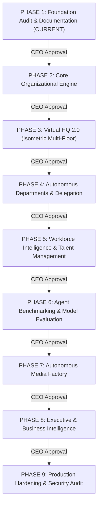

# AUTONOMIA – Master Multi-Phase Roadmap & Delivery Plan

## 1. Gated Phase Workflow Overview

Development proceeds in strictly gated phases. After each phase:
1. Automated unit & integration test suites run.
2. Verified visual screenshots captured at 1440x900 and 390px mobile widths.
3. Git commit with clean semantic messages.
4. `docs/autonomia/PROGRESS.md` updated with completed work, test results, and known issues.
5. **STOP and await explicit Human CEO signoff** before starting the next phase.

---

## 2. Detailed Phase Specifications

### Phase 1: Foundation Audit & Documentation (Current Phase)
- **Scope**: Comprehensive inspection of existing codebase, facts verification, database inventory, critical finding on backend-vs-simulation state, architecture design, and gap analysis.
- **Deliverables**:
  1. `docs/autonomia/MASTER_SPEC.md`
  2. `docs/autonomia/AUTONOMIA_PRODUCT_VISION.md`
  3. `docs/autonomia/AUTONOMIA_SYSTEM_ARCHITECTURE.md`
  4. `docs/autonomia/AUTONOMIA_MASTER_ROADMAP.md`
  5. `docs/autonomia/PHASE_1_FOUNDATION_AUDIT.md`
- **Gate**: Human CEO Review and Approval.

### Phase 2: Core Organizational Engine
- **Scope**: Ensure single employee record across all subsystems, dynamic department registry, task state machine hardening, persistent task queue surviving server reboots.
- **Acceptance Criteria**: All tasks persist across restarts; state changes emit typed events to `/ws`; zero data fabrication.

### Phase 3: Virtual HQ 2.0 (Isometric Pixel Art)
- **3.1 Visual System**: Palette restrictions (32 warm colors), 2:1 isometric tilemap engine, depth sorting.
- **3.2 Floor 0 Vertical Slice**: Enclosed cutaway diorama (CEO office, meeting table, lounge, cat, plants, real sprites) — *Completed and verified in `screenshots/floor0.png`*.
- **3.3 Floors 1, 4, and 5**: Media Studio (Floor 1), Campus Outreach (Floor 4), Tech Infrastructure (Floor 5).
- **3.4 Live Event-Driven Motion**: A* pathfinding on walkability grid; characters walk when tasks start/complete; zero teleportation.
- **3.5 Inter-Floor Transitions**: Escalator and elevator visual transitions connecting floors.
- **3.6 Legacy Mode Preservation**: `?view=legacy` remains 100% accessible.

### Phase 4: Autonomous Departments & Delegation
- **Scope**: Level 2 Executive Coordinator natural-language plan drafting; Level 3 Department Managers task graph decomposition; agent-to-agent task handoffs.
- **Acceptance Criteria**: Objective decomposition plan submitted to CEO Approval Gate; task handoff records logged to database.

### Phase 5: Workforce Intelligence & Continuous Improvement
- **5.1 Data Layer & Metrics**: Deterministic calculation of all 8 performance indicators; minimum sample size enforcement (10 tasks).
- **5.2 Lifecycle Engine**: State machine transitions (`candidate` → `in_testing` → `active` ↔ `in_retraining` ↔ `suspended` → `terminated`); append-only audit log; typed name confirmation on termination.
- **5.3 Recruitment Centre**: Job spec creation; sandboxed test runner; score evaluation.
- **5.4 Workforce Advisor**: Deterministic statistical analysis + LLM reasoning; evidence citation verification; no direct state mutation.
- **5.5 Continuous Improvement Loop**: Organizational weakness detection, recruitment drafting, 30-day closed-loop impact tracking.

### Phase 6: Agent Benchmarking & Model Evaluation
- **Scope**: Head-to-head evaluation tasks for overlapping agent roles across Gemini 2.5, OpenRouter models, and Nemotron.
- **Acceptance Criteria**: Normalized cost vs speed vs accuracy scoring.

### Phase 7: Autonomous Media Factory
- **Scope**: Script-to-video generation pipeline; FFmpeg multi-scene dynamic assembly; Ken Burns camera motion; animated typography; Video QA Lab rubric integration.
- **Acceptance Criteria**: Rendered 16:9 masterclass videos; automated defect repair reporting exact metrics.

### Phase 8: Executive & Business Intelligence
- **Scope**: Real token spend tracking, department cost attribution, financial forecasting, and parameterized read-only CEO Q&A engine.
- **Acceptance Criteria**: Zero hallucinated SQL queries; all financial answers cite real record IDs.

### Phase 9: Production Hardening & Security Audit
- **Scope**: Server-side RBAC penetration test; rate-limiting expensive LLM endpoints; graceful error recovery; full backup verification.
- **Acceptance Criteria**: End-to-end scenario from Section 17 verified against live database.
