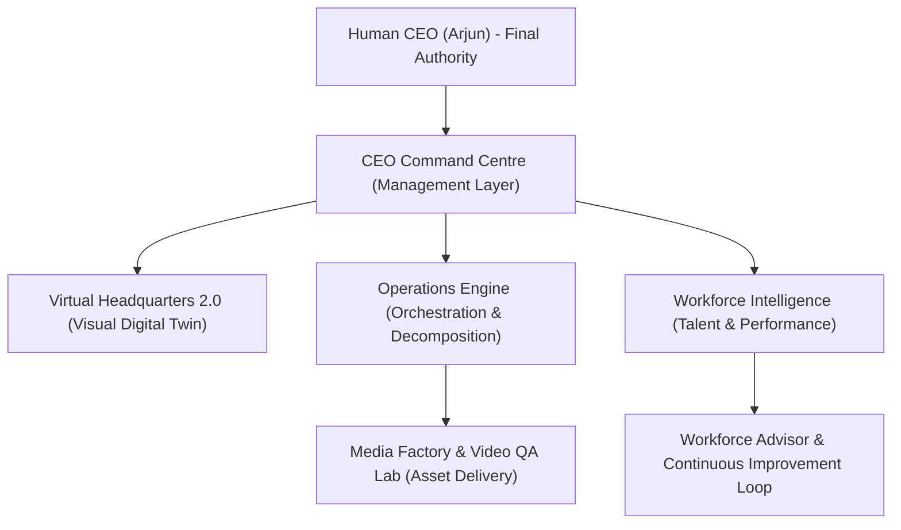

# AUTONOMIA – Product Vision & Core Philosophy

## 1. Executive Summary

**AUTONOMIA** is an autonomous AI-powered digital enterprise. It transforms AI from isolated prompt-completion assistants into an interconnected, accountable corporate workforce operating inside an interactive visual digital twin: the **Virtual Headquarters**.

In AUTONOMIA, specialized AI agents act as employees structured into functional departments (Executive Management, Media & Creative Studio, Campus Outreach & Documentation, Technology & Infrastructure). They plan, decompose, execute, quality-check, and deliver real-world business objectives—specifically video production, software automation tutorials, social publishing, and campus event campaigns.

Critically, **the human CEO (Arjun) retains absolute strategic authority and final decision-making power**. The system observes, measures, diagnoses, drafts, and recommends; the CEO reviews, edits, and authorizes.

---

## 2. The Five Pillars of AUTONOMIA

### Pillar 1: The Virtual Headquarters 2.0 (Visual Digital Twin)
The Virtual HQ is the living, visual manifestation of the enterprise. Rendered in clean **2:1 isometric pixel art** (32x16/64x32 diamond tiles, enclosed cutaway rooms with wall thickness, windows, decor, and depth-sorted pixel sprites), every visual entity directly reflects live backend state. When an agent is at their desk typing, an actual LLM task or render job is actively executing.

### Pillar 2: The Operations Engine (Hierarchical Execution)
- **Level 1 (CEO)**: Provides high-level natural-language intent (e.g., *"Create a YouTube masterclass on UiPath Studio Automation"*).
- **Level 2 (Executive Coordinator)**: Analyzes goals, formulates a multi-department dependency plan, projects token costs, and stages approval requests.
- **Level 3 (Department Managers)**: Decomposes goals into specialized task graphs, balances agent workload, and reviews output artifacts.
- **Level 4 (AI Employees)**: Executes research, drafting, code compilation, video rendering, motion graphics, and QA checks.

### Pillar 3: CEO Command Centre (Governance & Auditing)
The executive cockpit for organizational monitoring. Displays live telemetry, operational costs, active pipelines, pending approvals, and provides an audited Q&A interface that queries real SQLite database records without LLM hallucination.

### Pillar 4: Workforce Intelligence & Talent Management
Treats AI agents as long-term corporate assets with measurable ROI.
- **Deterministic 8-Indicator Leaderboard**: Task completion rate, output quality, accuracy, execution time, cost per task, failure rate, collaboration score, and human approval rate.
- **Immutable Configuration Versioning**: Every prompt change, tool permission adjustment, or model upgrade is stored as an immutable version with instant rollback capability.
- **AI Recruitment Centre & Sandbox Gate**: New agent candidates must prove their competency in an isolated sandbox with zero production access before being staged for CEO hiring approval.

### Pillar 5: Continuous Improvement Loop
An autonomous diagnostic feedback cycle:
$$\text{Measure} \longrightarrow \text{Diagnose} \longrightarrow \text{Recommend} \longrightarrow \text{CEO Decision} \longrightarrow \text{Execute} \longrightarrow \text{Verify Impact} \longrightarrow \text{Repeat}$$
- Detects bottlenecks, single points of failure, and capability gaps.
- Drafts recruitment job specs pre-filled with test tasks.
- Tracks 30-day closed-loop before/after impact of executive decisions without causal fabrication.

---

## 3. Strict Authority Boundaries

1. **Server-Side Enforcement**: No client-side UI flag can bypass permission checks. The backend verifies cryptographic principal roles (`Role.CEO`) before executing any state-changing action.
2. **Zero Delegated Authority**: No cron job, autonomous agent, or supervisor script can auto-approve hiring, promotions, terminations, salary/budget increases, or external publishing.
3. **Audit Immutability**: All decisions, transitions, and authorizations write strictly append-only records to `workforce_audit_logs`.
