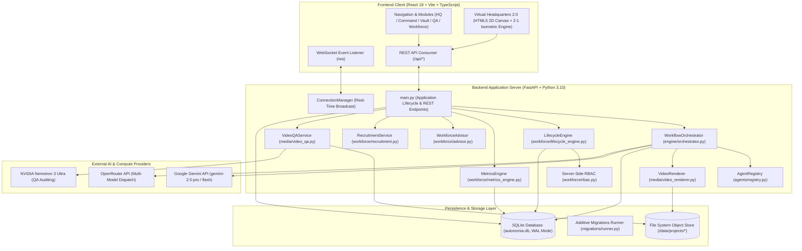

# AUTONOMIA – System Architecture & Technical Topology

## 1. High-Level System Architecture

---

## 2. Core Subsystems

### 2.1 The Application Server (`backend/app/`)
* **Framework**: FastAPI (async ASGI) on Uvicorn.
* **Concurrency**: Pure `asyncio` event loop. Non-blocking database calls via `aiosqlite`.
* **State Management**: Singleton services (`GLOBAL_ORCHESTRATOR`, `GLOBAL_LIFECYCLE_ENGINE`) maintain live orchestrator queues and agent active state, backed continuously by SQLite persistence.

### 2.2 Database Schema & Persistence
Located at `backend/app/database/models.py` and `backend/app/database/workforce_models.py`.
- **`organizations`**: Multi-tenant foundation (default tenant `org_autonomia_01`).
- **`departments`**: Dynamic organizational units with budget allocations, floor IDs, and manager foreign keys.
- **`workforce_employees`**: The single source of truth for agent employment state (`candidate`, `in_testing`, `active`, `in_retraining`, `suspended`, `terminated`).
- **`workforce_agent_configs`**: Immutable, numbered versions of agent prompts, tool permissions, temperature, and models.
- **`tasks` & `workforce_task_telemetry`**: Full operational task records tracking duration, token counts, model spend in USD, and approval wait seconds.
- **`workforce_task_evaluations`**: Objective and reviewer scores (0-100) across technical accuracy, tone, and rubric alignment.
- **`workforce_recommendations`**: Staged workforce advice linking evidence task IDs, confidence scores, and CEO approval states.
- **`workforce_audit_logs`**: Append-only compliance log recording timestamp, actor, action, previous/new state, and authorization token.

### 2.3 Real-Time Event Communication
- **Endpoint**: `ws://localhost:8080/ws`
- **Broadcast Events**:
  - `task_started`, `task_progress`, `task_completed`, `task_failed`
  - `approval_requested`, `approval_resolved`
  - `agent_transit_triggered`
  - `workforce_lifecycle_event` (hire, promote, retrain, suspend, terminate)
  - `qa_inspection_completed`, `qa_repair_completed`

---

## 3. The Isometric Visual Engine (`frontend/src/components/isometric/`)

### 3.1 Mathematical Projection Model
True 2:1 isometric projection:
$$x_{\text{screen}} = \text{originX} + (g_x - g_y) \cdot \frac{W_{\text{tile}}}{2}$$
$$y_{\text{screen}} = \text{originY} + (g_x + g_y) \cdot \frac{H_{\text{tile}}}{2} - g_z$$
where $W_{\text{tile}} = 64\text{px}$, $H_{\text{tile}} = 32\text{px}$ ($\frac{W_{\text{tile}}}{H_{\text{tile}}} = 2.0$).

### 3.2 Depth Sorting (Painter's Algorithm)
All architectural walls, furniture components, prop accessories, and personnel are assigned a unique depth scalar:
$$\text{DepthKey} = (g_x + g_y) \cdot 100 + g_z$$
The render queue is sorted ascending before every frame pass. This guarantees characters walk behind front desks and in front of back walls with zero polygon sorting artifacts.
